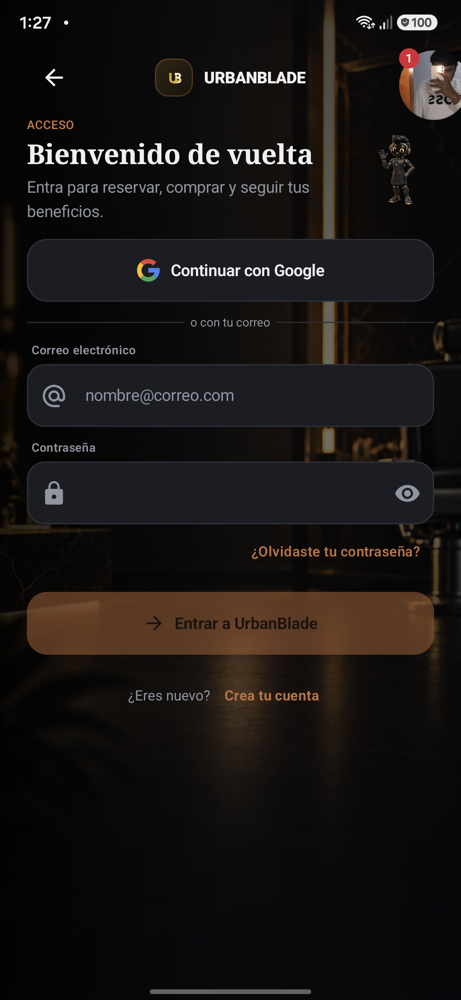

# UrbanBlade · Android

Aplicación Android nativa para reservas y operación de barbería. Desarrollada con Kotlin y Jetpack Compose; consume la API de UrbanBlade y adapta la navegación al rol de la sesión.

[Documentación](docs/README.md) · [Arquitectura](docs/ARQUITECTURA.md) · [Pruebas](docs/PRUEBAS.md) · [Contribución](CONTRIBUTING.md) · [Seguridad](SECURITY.md)

[](https://github.com/al140605/UrbanBladeMobile/actions/workflows/android-ci.yml)
[](https://github.com/al140605/UrbanBladeMobile/actions/workflows/codeql.yml)

## Aplicación

<table>
<tr><th>Acceso</th><th>Reservas como invitado</th></tr>
<tr>
<td></td>
<td></td>
</tr>
</table>

Capturas existentes de Android, conservadas sin edición: acceso del archivo de auditoría de septiembre de 2026 y reservas de la validación del 11 de octubre de 2026. Son evidencia histórica de interfaz, no una certificación del build actual. [Procedencia y alcance](docs/CAPTURAS.md).

## Alcance funcional

| Perfil | Áreas de la aplicación |
|---|---|
| Cliente | Reservas, tienda, pedidos, pagos, perfil y notificaciones |
| Barbero | Agenda personal, horario y portafolio |
| Recepción | Agenda operativa, clientes, cobros, pedidos e inventario |
| Administración | Operación, gestión, reportes y configuración |
| Ingeniería | Consulta de reportes, métricas, logs y estado del sistema |

Laravel conserva la autorización y las reglas de precios, stock y disponibilidad. La presencia de una pantalla no acredita la validación integral del flujo: consultar las [pruebas y sus límites](docs/PRUEBAS.md).

## Entorno de desarrollo

| Componente | Configuración versionada |
|---|---|
| Lenguaje / UI | Kotlin 2.2.10 / Jetpack Compose y Material 3 |
| Compilación | Android Gradle Plugin 9.4.1 / Gradle Wrapper 9.6.0 |
| JVM de Gradle | JetBrains JDK 21 |
| Bytecode | Java y Kotlin 17 |
| Android | SDK de compilación y destino 36; mínimo 26 |
| Versión de la app | 3.0.0, código 3 |

Instalar Android Studio, SDK 36 y JDK 21. Abrir la raíz del repositorio y configurar `sdk.dir` en `local.properties` o `ANDROID_HOME`. El archivo local es privado y no se versiona.

Desde PowerShell:

```powershell
.\gradlew.bat :app:assembleDebug --console=plain
```

En Linux y macOS usar `./gradlew`. El wrapper fija versión y checksum; no se necesita Gradle global. El APK queda en `app/build/outputs/apk/debug/app-debug.apk`. Compilar no instala la app.

## Configuración y API

| Variante | URL predeterminada | Uso |
|---|---|---|
| `debug` | `http://10.0.2.2:8000/api/v1/` | Backend local desde el emulador |
| `staging` | `https://api.urbanblade.com.mx/api/v1/` | Entorno remoto configurado; confirmar datos y permisos antes de probar |
| `release` | Placeholder hasta configurar `RELEASE_API_BASE_URL` | Distribución con configuración y firma verificadas |

El nombre de una variante no garantiza que sus datos estén aislados. Configurar explícitamente la API local cuando se requieran pruebas sintéticas. No ejecutar migraciones ni sembrar datos como parte de la instalación del cliente.

Las propiedades se leen desde `local.properties` o `-P`: `DEBUG_API_BASE_URL`, `STAGING_API_BASE_URL`, `RELEASE_API_BASE_URL`, `GOOGLE_CLIENT_ID` y `STRIPE_PUBLISHABLE_KEY`. Consultar [configuración por entorno](docs/CONFIGURACION.md) para dispositivo físico, Firebase, firma y pagos.

## Verificación

```powershell
.\gradlew.bat :app:lintDebug :app:testDebugUnitTest :app:createDebugUnitTestCoverageReport :app:assembleDebug --console=plain
```

La suite incluye una comprobación TLS pública contra la API y necesita conectividad. No omitir pruebas ni desactivar TLS para obtener un resultado verde.

Android CI ejecuta lint, pruebas JVM sin omisiones, cobertura y builds debug/release con R8. CodeQL analiza Java/Kotlin con compilación explícita. [Evidencia y reproducción](docs/PRUEBAS.md).

CI no publica en Google Play ni acredita una prueba en dispositivo. La generación de un AAB firmado se trata en el [procedimiento de publicación](docs/PUBLICAR_PLAY_STORE.md).

## CI y distribución

Los workflows verifican compilación y calidad; no publican en Google Play. Consultar [CI/CD](docs/CI_CD.md) para disparadores, artefactos, permisos y flujo de PR. Revisar las integraciones externas antes de publicar un cambio.

## Organización

```text
app/src/main/java/com/urbanblade/mobile/
  core/                 Red, sesión, pagos, push y configuración
  data/model/           Modelos de intercambio
  data/repository/      Acceso a datos remotos
  ui/                   Pantallas, navegación, estado y componentes
app/src/test/           Pruebas JVM y componentes con Robolectric
.github/workflows/      Android CI y CodeQL
```

## Proyecto y políticas

[API de UrbanBlade](https://github.com/KikeGonRam/barber) · [Cliente web](https://github.com/KikeGonRam/frontend_Urbanblade)

Consultar la [seguridad documental](docs/SEGURIDAD_DOCUMENTACION.md) antes de compartir capturas, logs o ejemplos.

El código se distribuye bajo [GPL-3.0-only](LICENSE). Consultar el [alcance de la licencia](LICENSING.md), el [código de conducta](CODE_OF_CONDUCT.md) y el canal privado de [reporte de vulnerabilidades](SECURITY.md). La licencia del código no concede acceso a cuentas, datos, servicios ni derechos sobre material de terceros.
