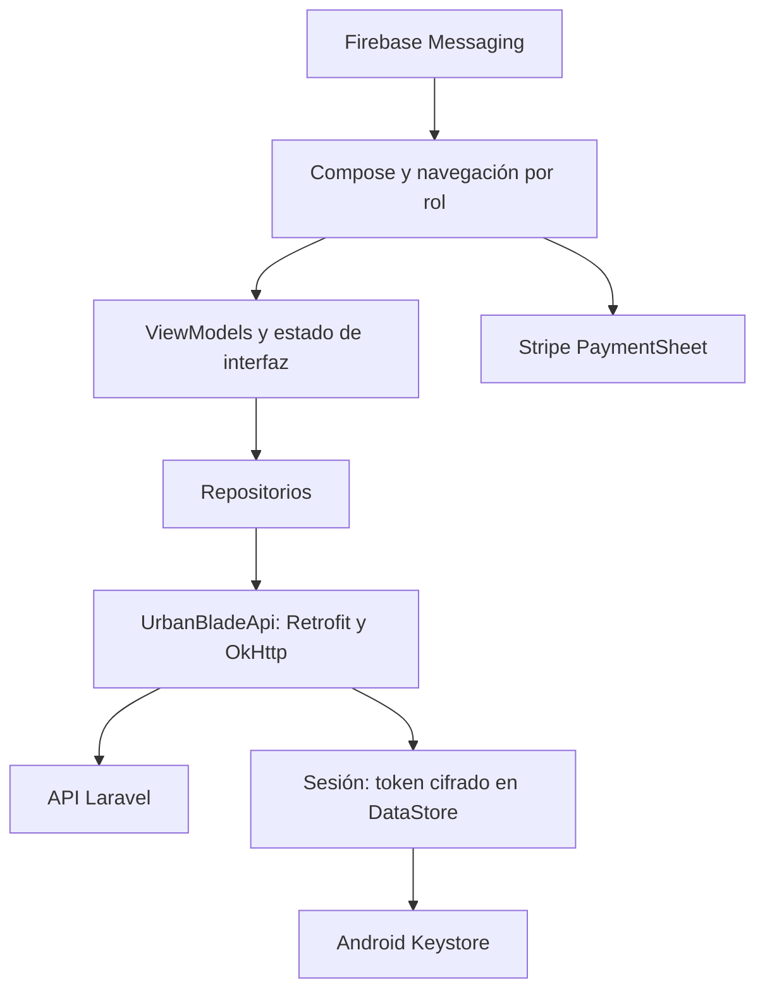

# Arquitectura de UrbanBlade Mobile

## Contexto

Cliente Android nativo con Compose y organización MVVM. Consume la API HTTP de UrbanBlade; el backend conserva las reglas de negocio y la autorización. El módulo `app` contiene la aplicación: esta organización no implica módulos Gradle separados ni una capa de dominio independiente.

## Responsabilidades

| Ubicación | Responsabilidad |
|---|---|
| `ui/` | Composición, entrada del usuario, navegación y estado de pantalla |
| `data/model/` | Representación de respuestas y solicitudes |
| `data/repository/` | Coordinación del acceso remoto |
| `core/network/UrbanBladeApi.kt` | Declaraciones de endpoints Retrofit |
| `core/network/AppContainer.kt` | Construcción de dependencias y cliente HTTP |
| `core/session/` | Sesión, eventos y persistencia del token |
| `core/access/` | Experiencia visible según el usuario |
| `core/payment/` | Integración cliente de Stripe |
| `core/push/` | Recepción, registro y navegación de notificaciones |

Las rutas son relativas a la raíz Java/Kotlin indicada en el README. Ver [auditoría de contratos](AUDITORIA_CONTRATOS_API.md); verificar una ruta no acredita el payload, los permisos ni el flujo completo.

## Sesión y límites de confianza

La API devuelve el token tras la autenticación. El cliente lo incorpora a las solicitudes protegidas. `TokenCipher` implementa AES-256-GCM antes de persistirlo en DataStore y obtiene la clave mediante Android Keystore. El fallo de descifrado devuelve un resultado nulo; no debe tratarse como una sesión válida.

La navegación adapta acciones al rol, pero la interfaz no es una barrera de autorización. El servidor debe validar cada operación, identidad, precio, inventario y transición de estado. Las contraseñas y claves secretas de Stripe no forman parte de la configuración de la app.

## Integraciones

- Retrofit y OkHttp gestionan HTTP, autenticación y pinning. Los cambios de certificados requieren revisar la prueba TLS y el plan de rotación; no desactivar la comprobación.
- Stripe PaymentSheet presenta el pago. El servidor crea y confirma los intentos conforme a sus reglas; un resultado de interfaz no sustituye la confirmación del backend.
- Firebase se habilita según la configuración privada disponible. Sin `google-services.json`, las compilaciones de verificación siguen disponibles y no acreditan funcionamiento de push o telemetría.
- Las variantes separan la configuración de red y compilación. Los datos del entorno deben comprobarse antes de cualquier prueba que escriba.

## Evolución y límites

Las pruebas JVM incluyen lógica, contratos de componentes y TLS; no sustituyen la validación en Android real. No se declara soporte offline completo ni paridad integral con la web. Revisar [decisiones](DECISIONES.md), [configuración](CONFIGURACION.md) y [pruebas](PRUEBAS.md) antes de ampliar un módulo.
