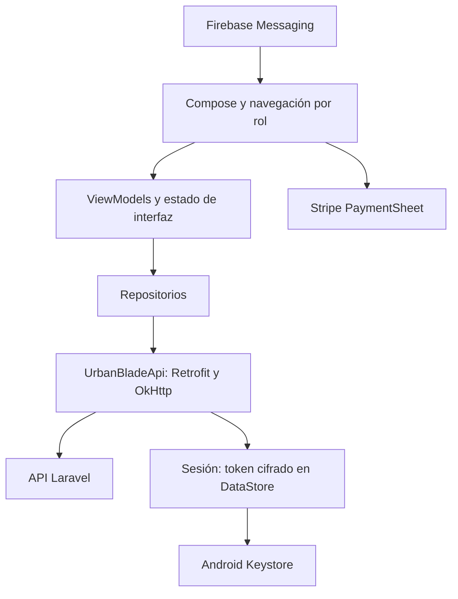

# Arquitectura de UrbanBlade Mobile

## Contexto

Cliente Android nativo con Compose y organización MVVM. Consume la API HTTP de UrbanBlade; el backend conserva las reglas de negocio y la autorización. El módulo `app` contiene la aplicación: esta organización no implica módulos Gradle separados ni una capa de dominio independiente.

## Responsabilidades

| Ubicación | Responsabilidad |
|---|---|
| `ui/` | Composición, entrada del usuario, navegación y estado de pantalla |
| `data/model/` | Representación de respuestas y solicitudes |
| `data/repository/` | Coordinación del acceso remoto |
| `core/network/UrbanBladeApi.kt` | Declaraciones de endpoints Retrofit |
| `core/network/AppContainer.kt` | Construcción de dependencias y cliente HTTP |
| `core/session/` | Sesión, eventos y persistencia del token |
| `core/access/` | Experiencia visible según el usuario |
| `core/payment/` | Integración cliente de Stripe |
| `core/push/` | Recepción, registro y navegación de notificaciones |

Las rutas son relativas a la raíz Java/Kotlin indicada en el README. Ver [auditoría de contratos](AUDITORIA_CONTRATOS_API.md); verificar una ruta no acredita el payload, los permisos ni el flujo completo.

## Sesión y límites de confianza

La API devuelve el token tras la autenticación. El cliente lo incorpora a las solicitudes protegidas. `TokenCipher` implementa AES-256-GCM antes de persistirlo en DataStore y obtiene la clave mediante Android Keystore. El fallo de descifrado devuelve un resultado nulo; no debe tratarse como una sesión válida.

La navegación adapta acciones al rol, pero la interfaz no es una barrera de autorización. El servidor debe validar cada operación, identidad, precio, inventario y transición de estado. Las contraseñas y claves secretas de Stripe no forman parte de la configuración de la app.

## Integraciones

- Retrofit y OkHttp gestionan HTTP, autenticación y pinning. Los cambios de certificados requieren revisar la prueba TLS y el plan de rotación; no desactivar la comprobación.
- Stripe PaymentSheet presenta el pago. El servidor crea y confirma los intentos conforme a sus reglas; un resultado de interfaz no sustituye la confirmación del backend.
- Firebase se habilita según la configuración privada disponible. Sin `google-services.json`, las compilaciones de verificación siguen disponibles y no acreditan funcionamiento de push o telemetría.
- Las variantes separan la configuración de red y compilación. Los datos del entorno deben comprobarse antes de cualquier prueba que escriba.

## Autorización local de pagos con tarjeta

Antes de presentar el checkout de Stripe o confirmar una tarjeta guardada, Android
solicita verificar el bloqueo del dispositivo. `PaymentAuthorization.kt` concentra
esta verificación para citas, reservas, membresías y beneficios. No se aplica al
efectivo ni al envío de comprobantes, porque esas acciones no confirman un cargo
con tarjeta desde el SDK.

- Android 11 o superior: diálogo nativo `BiometricPrompt` con biometría fuerte o
  credencial de bloqueo. Según la configuración del teléfono, puede ofrecer huella,
  PIN, patrón o contraseña. No se acepta biometría débil como alternativa.
- Android 8–10: confirmación nativa de PIN, patrón o contraseña de bloqueo.
- Sin bloqueo seguro, ante error o cancelación: no se abre ni confirma el cobro.
  La operación puede reintentarse después de configurar el bloqueo.
- Cada verificación se consume una sola vez. Los toques repetidos no sustituyen la
  operación pendiente y los resultados tardíos no autorizan una solicitud nueva.
  Al salir de la pantalla o recrearla se cancela la autorización pendiente.

La app no recibe ni almacena la huella o el PIN. Se usa la respuesta del sistema;
no se persiste una marca de «ya autorizado». En el flujo de tarjeta nueva, esta
verificación permite abrir el checkout: Stripe conserva su propia confirmación
final y puede exigir además 3DS. La creación de un intento en backend puede ocurrir
antes del diálogo; cancelar la verificación no confirma ese intento.

Es una protección de experiencia local, no una prueba criptográfica enviada al
servidor ni una defensa contra un cliente modificado. El servidor conserva la
autoridad del importe y la conciliación por webhook. Esta verificación no sustituye
la identidad de la cuenta, los permisos de API ni la autenticación de Stripe.

Referencia: [autenticación biométrica de Android](https://developer.android.com/identity/sign-in/biometric-auth).

## Evolución y límites

Las pruebas JVM incluyen lógica, contratos de componentes y TLS; no sustituyen la validación en Android real. No se declara soporte offline completo ni paridad integral con la web. Revisar [decisiones](DECISIONES.md), [configuración](CONFIGURACION.md) y [pruebas](PRUEBAS.md) antes de ampliar un módulo.
